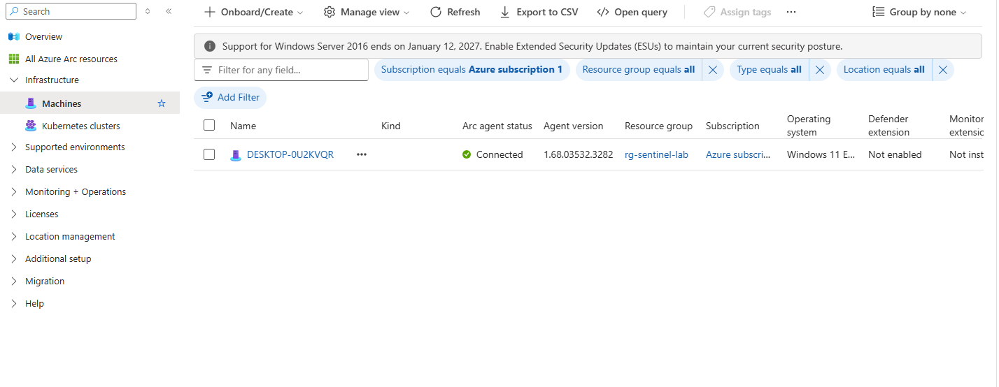
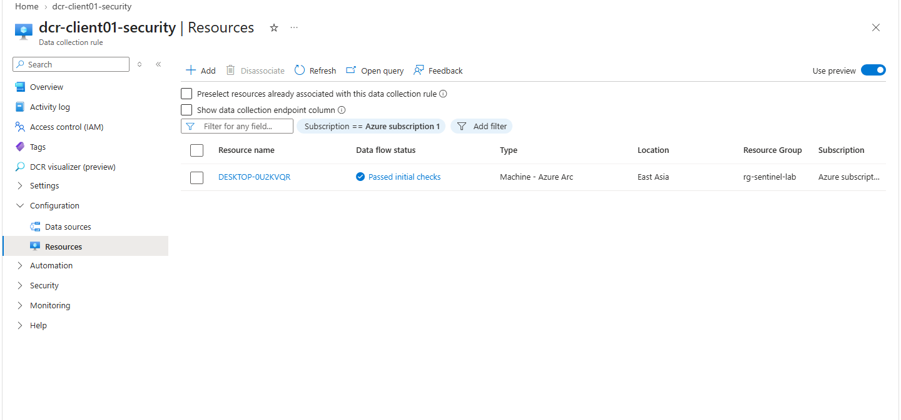
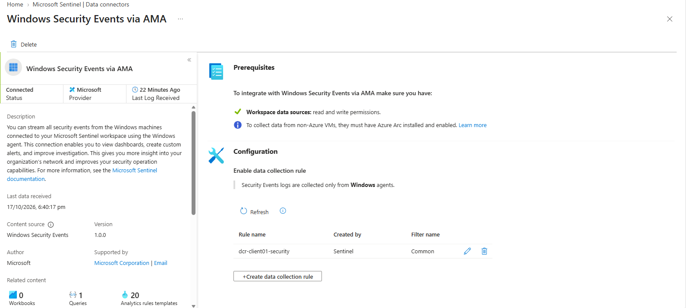
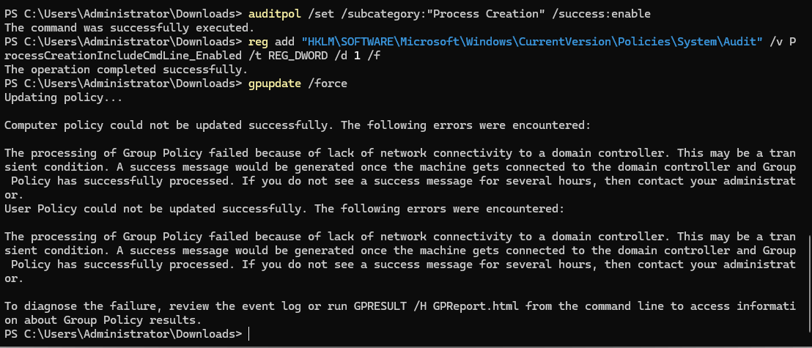
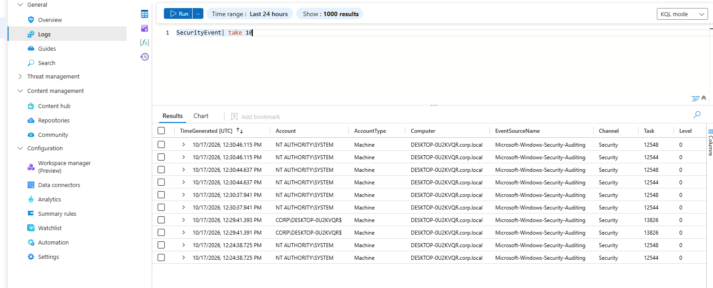
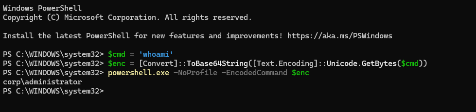
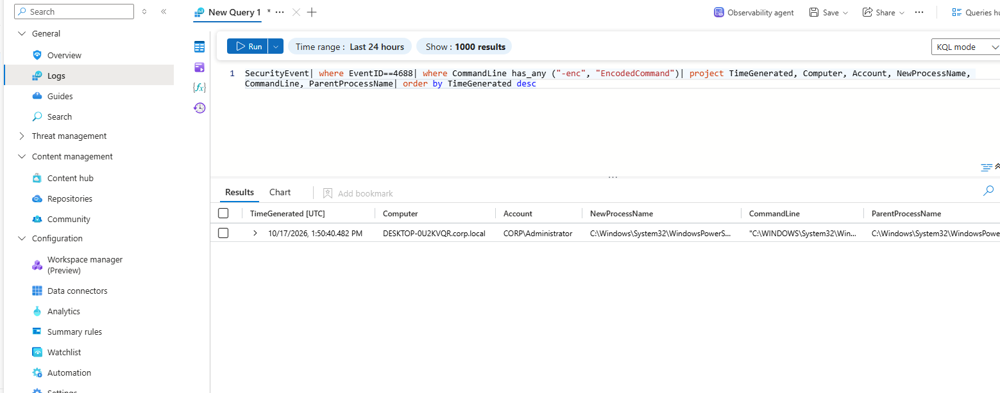
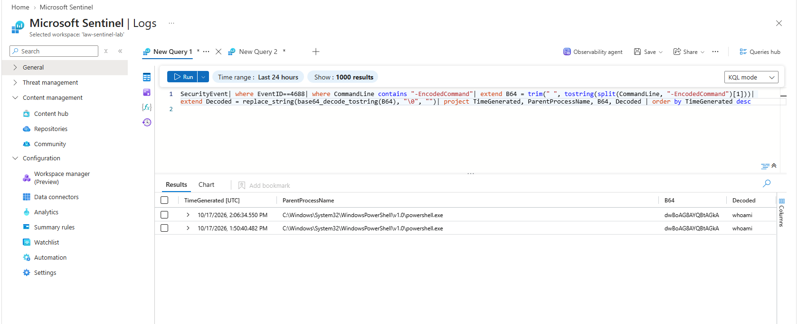
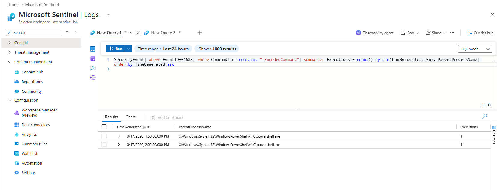
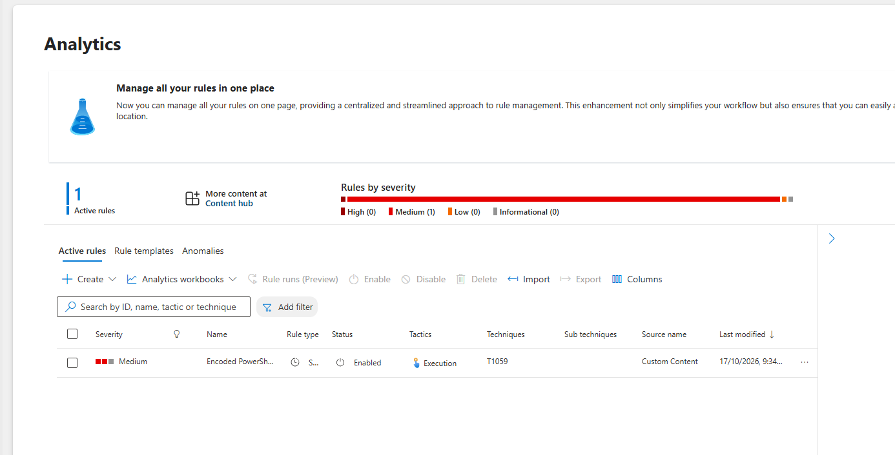

# Hunting Encoded PowerShell with Microsoft Sentinel (KQL)

After the Splunk lab, I wanted to try the same idea in a second SIEM: attack my own lab machine, then find the activity in the logs the way a SOC analyst would. This time it was Microsoft Sentinel and KQL, and the behaviour I picked was encoded PowerShell, something attackers use a lot to hide what a command is really doing.

Getting the logs into Sentinel took more work than the hunt itself, so this write-up covers both: how the data got there, and what I did with it once it arrived.

## Lab environment

| Role | Name | Details |
|---|---|---|
| Target machine | Client01 | Windows 11 VM, hostname `DESKTOP-0U2KVQR.corp.local`, joined to my `corp.local` lab domain |
| SIEM | Microsoft Sentinel | Workspace `law-sentinel-lab`, East Asia, on the 31-day free trial |
| Log collection | Azure Arc + Azure Monitor Agent | Connector: Windows Security Events via AMA (Common events) |
| Data collection rule | `dcr-client01-security` | Attached to Client01 |
| Table / Event ID | `SecurityEvent` / 4688 | Process creation, with command line logging turned on |

## How I set this up

Client01 runs on my own computer, not in Azure, and Sentinel's Windows connector only lists machines it can see in an Azure subscription. So the first job was registering Client01 with **Azure Arc**, which makes a non-Azure machine show up as an Azure resource. I generated the onboarding script in the portal, ran it in an administrator PowerShell window on Client01, signed in with the device code, and the machine appeared as **Connected**.

<p align="center"> 
<kbd><kbd></kbd></kbd><br>
  <em>Client01 registered in Azure Arc and showing as Connected.</em> 
</p> 
<br>

Then I created the data collection rule from the Windows Security Events connector and attached Client01 to it.

<p align="center">
<kbd><kbd></kbd></kbd><br>
<em>The collection rule is associated with Client01 and has passed its initial checks.</em>
</p>
<br>

<p align="center">
<kbd><kbd></kbd></kbd><br>
<em>The Windows Security Events via AMA connector showing Connected, using the rule <code>dcr-client01-security</code>.</em>
</p>
<br>

## Everything that needed fixing first

**Azure account and region.** My first attempt used my college account, which only allowed a few regions, and Sentinel wasn't available in any of them. I switched to a personal Azure free account and created the resource group and workspace in East Asia, where Sentinel is supported.

**Command line logging.** By default, Event 4688 records that a process started but not the command that started it. Without the command line there is nothing to hunt for, so I turned on process creation auditing and command line logging from an administrator PowerShell window:

```powershell
auditpol /set /subcategory:"Process Creation" /success:enable
reg add "HKLM\SOFTWARE\Microsoft\Windows\CurrentVersion\Policies\System\Audit" /v ProcessCreationIncludeCmdLine_Enabled /t REG_DWORD /d 1 /f
gpupdate /force
```

<br>
<p align="center">
<kbd><kbd></kbd></kbd><br>
<em>Auditing and command line logging enabled. The last command failed, which is explained below.</em>
</p>
<br>

The first two commands worked. `gpupdate /force` failed because DC01 was powered off, so Client01 couldn't reach a domain controller. That was fine for this lab: both settings were already applied locally by the first two commands, so I carried on. In a real domain I would push this setting through Group Policy instead.

## Making sure the data was actually arriving

Before hunting for anything, I checked that Windows events were landing in the workspace at all.

```kql
SecurityEvent
| take 10
```

<br>
<p align="center">
<kbd><kbd></kbd></kbd><br>
<em>Security events from Client01 flowing into the <code>SecurityEvent</code> table.</em>
</p>
<br>

Events were coming in from `DESKTOP-0U2KVQR.corp.local`, mostly under `NT AUTHORITY\SYSTEM`, which is normal background activity. That confirmed the pipeline worked end to end.

## Running the encoded command

I wanted something harmless that still looks like what an attacker would run. PowerShell's `-EncodedCommand` option takes a Base64 string, so the command doesn't appear in plain text. I encoded `whoami` and ran it:

```powershell
$cmd = 'whoami'
$enc = [Convert]::ToBase64String([Text.Encoding]::Unicode.GetBytes($cmd))
powershell.exe -NoProfile -EncodedCommand $enc
```

<br>
<p align="center">
<kbd><kbd></kbd></kbd><br>
<em>Running the Base64-encoded command on Client01. It prints <code>corp\administrator</code>.</em>
</p>
<br>

PowerShell decoded and ran it, and printed `corp\administrator`. On screen it looks like nothing happened, which is the point: anyone reading the command line would only see a block of letters.

## Hunting for it in Sentinel

**First, find the process creation events that used an encoded command**

```kql
SecurityEvent
| where EventID==4688
| where CommandLine has_any ("-enc", "EncodedCommand")
| project TimeGenerated, Computer, Account, NewProcessName, CommandLine, ParentProcessName
| order by TimeGenerated desc
```

<br>
<p align="center">
<kbd><kbd><kbd></kbd></kbd></kbd><br>
<em>Hunt for Event 4688 with <code>-enc</code> or <code>EncodedCommand</code> in the command line. The command line column is cut off in this view, and the decoded payload is in the next screenshot.</em>
</p>
<br>

The hunt found a process creation under `CORP\Administrator`, started by PowerShell. At the time of this screenshot there was a single result. A second matching event shows up in the next two screenshots.

**Then decode the payload**

An encoded command only helps an attacker until someone decodes it. KQL can do that directly. This query pulls out the Base64 text and decodes it:

```kql
SecurityEvent
| where EventID==4688
| where CommandLine contains "-EncodedCommand"
| extend B64 = trim(" ", tostring(split(CommandLine, "-EncodedCommand")[1]))
| extend Decoded = replace_string(base64_decode_tostring(B64), "\0", "")
| project TimeGenerated, ParentProcessName, B64, Decoded
| order by TimeGenerated desc
```

PowerShell encodes commands as UTF-16, so the decoded text contains null characters between letters. The `replace_string` part removes them so the result is readable.

<br>
<p align="center">
<kbd><kbd></kbd></kbd><br>
<em>The Base64 string <code>dwBoAG8AYQBtAGkA</code> decoded back to <code>whoami</code>, for both events.</em>
</p>
<br>

Both events decode to `whoami`, and the parent process for both is `powershell.exe`. In a real investigation this is the step that matters most, because the decoded text tells you what the attacker was trying to do.

**Last, look at when it happened**

```kql
SecurityEvent
| where EventID==4688
| where CommandLine contains "-EncodedCommand"
| summarize Executions = count() by bin(TimeGenerated, 5m), ParentProcessName
| order by TimeGenerated asc
```

<br>
<p align="center">
<kbd><kbd></kbd></kbd><br>
<em>Encoded command executions grouped into 5-minute windows.</em>
</p>
<br>

The events fall in two separate 5-minute windows, one execution each: 13:50 and 14:06 UTC. A lone event like this is not a pattern on its own. In real traffic I would look for the same host or account doing it repeatedly, or encoded commands that decode to something suspicious.

## Turning the hunt into a rule

Hunting by hand only works while someone is looking, so I turned the idea into a scheduled analytics rule in Sentinel.

<p align="center">
<kbd><kbd></kbd></kbd><br>
<em>The scheduled analytics rule, enabled, with severity Medium and tactic Execution.</em>
</p>
<br>

The rule is named "Encoded PowerShell command (4688)". It runs every 5 minutes over a 1-hour lookback and raises an alert when the query returns any results. In the portal it is tagged with technique T1059. I created and enabled it but did not check whether it actually fired, so I'm treating it as built, not proven.

## So what actually happened here

This was a simulated attack that I ran myself, and the detection logic found it in the logs (a true positive). The command itself was harmless, but the behaviour is the same as what attackers do: run PowerShell with an encoded command so the real instruction isn't visible in the command line.

### MITRE ATT&CK mapping

| Tactic | Technique | Evidence |
|---|---|---|
| Execution | T1059.001 Command and Scripting Interpreter: PowerShell | Event 4688 with `-EncodedCommand`, parent `powershell.exe`, account `CORP\Administrator` |

**Severity:** Low in this lab, because the payload was only `whoami`. The same pattern with a payload that downloads a file or touches credentials would be High.

## If this were real

1. Decode the payload first, to see what the command actually does.
2. Check who ran it and from where. In this case it was `CORP\Administrator` on Client01, started by PowerShell.
3. Look at what else that host did around the same time, such as other new processes, network connections or logons.
4. If the payload is malicious, isolate the host and reset the account's credentials.
5. If it turns out to be a legitimate admin or management tool, tune the rule for that tool rather than switching it off.

## Limitations

- This is a single lab machine and a harmless command, so the rule has not been tested against real-world noise. Plenty of legitimate software also uses encoded commands, so in production it would produce false positives that need tuning.
- The rule matches on the command line text, so an attacker who avoids `-EncodedCommand` or its short forms would get past it.
- Command line logging was turned on locally with `auditpol` and a registry value, because DC01 was off and Group Policy couldn't be updated.
- I only remember running the command once, but Sentinel recorded two matching events 16 minutes apart. I didn't investigate why, so I'm reporting what the logs show and not guessing.
- I created and enabled the analytics rule but did not confirm that it triggered an alert.
- The lab resources have since been removed, so the queries can't be re-run from this repo. The screenshots are the record.

## What I actually learned from this

The KQL was the easy part. The hard part was getting reliable data into the SIEM: a machine outside Azure that needed Arc before it could connect, a Windows setting that hides command lines by default, and a Group Policy update that failed because another VM was off. Without command line logging turned on, the 4688 events would have shown that PowerShell started and nothing about what it ran.

If I did this again, I would turn on command line logging before generating any activity, and I'd make sure DC01 was running so I could push the setting through Group Policy properly.

## Repo contents

```
kql-encoded-powershell/
├── README.md
├── queries/
│   ├── 01_verify_ingestion.kql
│   ├── 02_hunt_encoded_powershell.kql
│   ├── 03_decode_payload.kql
│   └── 04_execution_timeline.kql
└── screenshots/   (10 images)
```
