# Simulating Six Attacker Techniques and Detecting Them in Microsoft Sentinel (KQL)

My first two Sentinel labs each tested one thing. In [kql-encoded-powershell](../kql-encoded-powershell) I hunted for encoded PowerShell, and in [sentinel-windows-security-lab](../sentinel-windows-security-lab) I only got Windows logs into Sentinel. This time I wanted to try more than one behaviour, so I ran six techniques against my own Azure VM with Atomic Red Team and wrote a Sentinel analytics rule for each one.

It didn't all go smoothly. Most of the work was getting the right logs into Sentinel in the first place, so this write-up covers that as well as the rules.

## Lab environment

| Role | Name | Details |
|---|---|---|
| Target machine | `vm-win-lab` | Windows Server 2025, Azure VM, Central India |
| SIEM | Microsoft Sentinel | Workspace `law-soc-lab`, on the 31-day free trial |
| Log collection | Azure Monitor Agent | Two data collection rules: `dcr-windows-security` for the Security log and `dcr-windows-sysmon` for the Sysmon log |
| Endpoint logging | Sysmon | Community config, plus process creation auditing and command line logging |
| Attack simulation | Atomic Red Team | Run from PowerShell on the VM |
| Tables | `SecurityEvent`, `Event` | Security events and Sysmon events |

## How I set this up

In the last lab, only Windows Security events were reaching Sentinel. A lot of these techniques don't show up there, they show up in Sysmon. So before I attacked anything, I added Sysmon and a second collection rule.

<p align="center">
<kbd><kbd>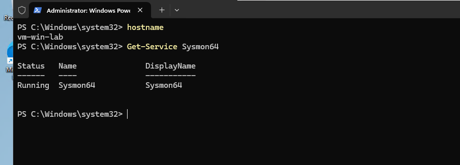</kbd></kbd><br>
<em>Sysmon running on <code>vm-win-lab</code>.</em>
</p>
<br>

The new rule collects the Sysmon log using its XPath query.

<p align="center">
<kbd><kbd>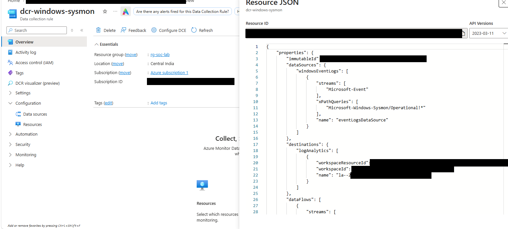</kbd></kbd><br>
<em>The <code>dcr-windows-sysmon</code> rule collecting <code>Microsoft-Windows-Sysmon/Operational</code>. The IDs are blacked out.</em>
</p>
<br>

Then I checked that every table was getting data before running any attack.

<p align="center">
<kbd><kbd>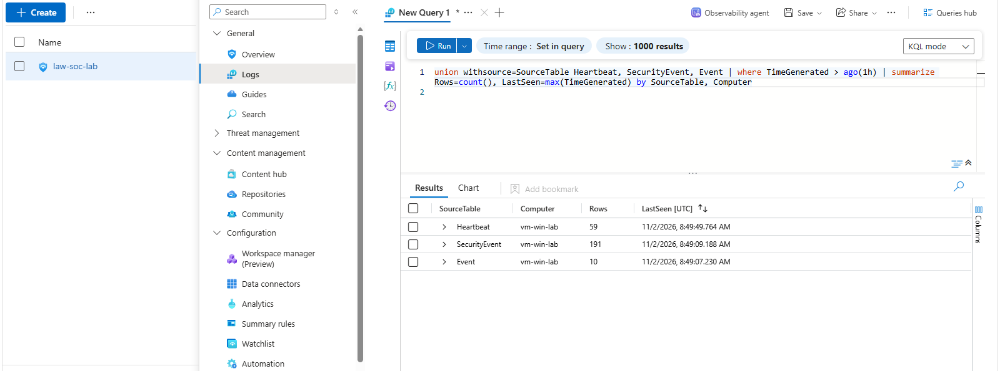</kbd></kbd><br>
<em>Heartbeat, <code>SecurityEvent</code> and <code>Event</code> all receiving data from <code>vm-win-lab</code> in the last hour.</em>
</p>
<br>

## Things that needed fixing first

**Auditing.** Windows doesn't log command lines or new scheduled tasks by default. I turned on process creation auditing and command line logging, and the "Other Object Access Events" setting. That last one is what makes Windows write EventID 4698 when a task is created.

**Sysmon wasn't in Sentinel.** I had only collected the Security log, so I added the second collection rule shown above.

**T1070.001 doesn't exist anymore.** I planned to test clearing event logs as T1070.001, but there was no Atomic folder for it. MITRE renumbered it to T1685.005 and Atomic Red Team follows the new ID. My Sentinel rule still has the old tag on it.

<p align="center">
<kbd><kbd>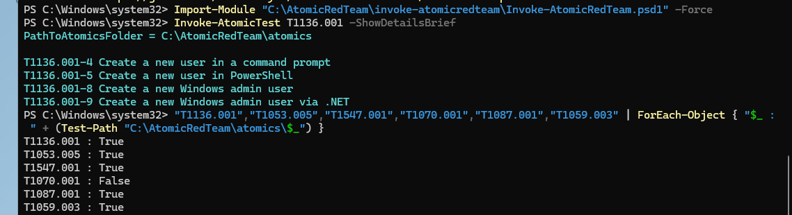</kbd></kbd><br>
<em>Checking which Atomic folders exist. T1070.001 comes back False because the technique moved to T1685.005.</em>
</p>
<br>

**The log I cleared isn't one I collect.** The test clears the System log, and that writes a System Event 104 on the VM. I only collect Security and Sysmon, so the 104 never reached Sentinel. I ended up detecting the `wevtutil` process in Sysmon instead.

**A wrong tag.** I first tagged the registry run key rule as T1547.002 by mistake and changed it to T1547.001.

**A password error.** My first T1136.001 run failed because the default password didn't meet the VM's password policy. I ran it again with my own password using `-InputArgs`.

**VM size.** When I started the VM again, the size I'd picked wasn't available, so I moved to a bigger one for the rest of the lab.

## The six techniques

| Technique | Tactic | Log source | Rule severity |
|---|---|---|---|
| T1136.001 Create Account: Local Account | Persistence | Security 4720 | Medium |
| T1053.005 Scheduled Task | Persistence | Security 4698 | Medium |
| T1547.001 Registry Run Keys | Persistence | Sysmon 13 | Medium |
| T1685.005 Clear Windows Event Logs (was T1070.001) | Defense Evasion | Sysmon 1 | Medium |
| T1087.001 Account Discovery: Local | Discovery | Sysmon 1 | Medium |
| T1059.003 Windows Command Shell | Execution | Sysmon 1 | Low |

That covers four tactics. I left out encoded PowerShell because it's already in my first Sentinel project.

## T1136.001: creating a local account

Atomic test 4 creates a user with `net user /add`. Windows logs that as EventID 4720. The first run failed because of the password policy, so the screenshot shows the failure and then the run that worked.

<p align="center">
<kbd><kbd>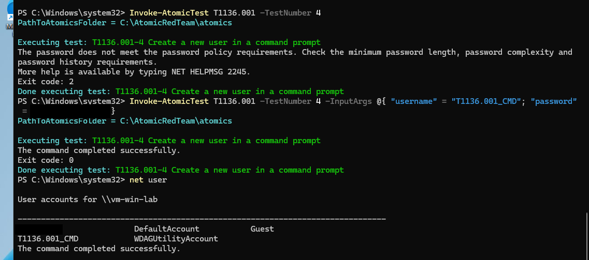</kbd></kbd><br>
<em>The first run was rejected and the second one created the test account. I blacked out the password and my admin username.</em>
</p>
<br>

```kql
SecurityEvent
| where TimeGenerated > ago(30m)
| where EventID == 4720
| project TimeGenerated, Computer, TargetUserName, SubjectUserName
```

<br>
<p align="center">
<kbd><kbd>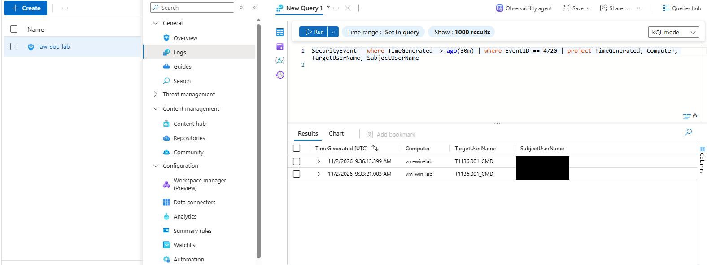</kbd></kbd><br>
<em>Two 4720 events for the test account.</em>
</p>
<br>

The rule fired and made an incident called "T1136.001 - Local account created". You can see it in the incident list in the next section. I deleted the account afterwards and checked it was gone.

## T1053.005: creating a scheduled task

Atomic test 2 makes a scheduled task called `spawn` with `schtasks`. Windows logs each new task as EventID 4698, but only after the audit setting I mentioned above.

<p align="center">
<kbd><kbd>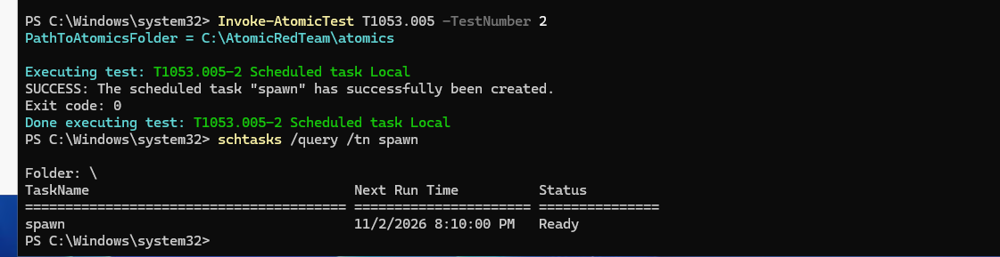</kbd></kbd><br>
<em>The task <code>spawn</code> created and confirmed with <code>schtasks /query</code>.</em>
</p>
<br>

```kql
SecurityEvent
| where EventID == 4698
| where TimeGenerated > ago(3h)
| extend TaskName = extract(@'Name="TaskName">([^<]+)<', 1, EventData)
| project TimeGenerated, Computer, SubjectUserName, TaskName
| order by TimeGenerated desc
```

<br>
<p align="center">
<kbd><kbd>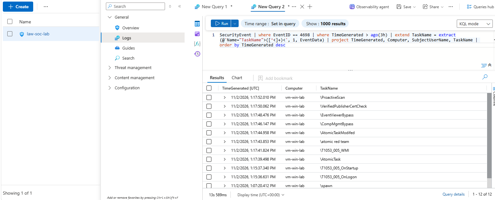</kbd></kbd><br>
<em>Task creation events in Sentinel. The extra task names come from other Atomic tests I ran for this technique.</em>
</p>
<br>

<p align="center">
<kbd><kbd>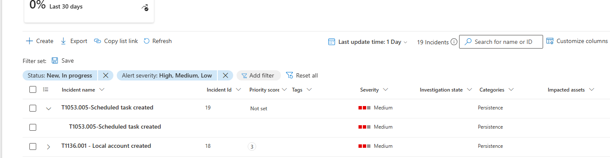</kbd></kbd><br>
<em>The scheduled task incident. The T1136.001 incident is listed just below it.</em>
</p>
<br>

## T1547.001: registry Run key

Atomic test 1 adds a value under the user's `Run` key with `reg add`. The Security log doesn't record this, but Sysmon does, as Event 13.

<p align="center">
<kbd><kbd>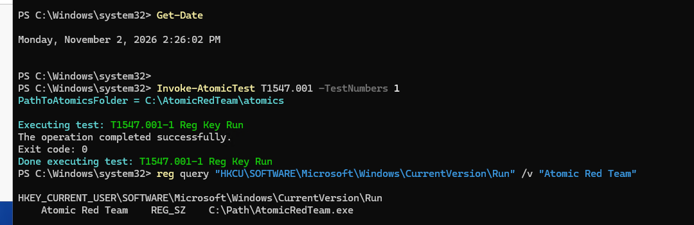</kbd></kbd><br>
<em>The Run key written and confirmed with <code>reg query</code>.</em>
</p>
<br>

```kql
Event
| where Source == "Microsoft-Windows-Sysmon"
| where EventID == 13
| where RenderedDescription has "CurrentVersion\\Run"
| extend TargetObject = extract(@"TargetObject: (.+)", 1, RenderedDescription)
| extend Image = extract(@"Image: (.+)", 1, RenderedDescription)
| extend Details = extract(@"Details: (.+)", 1, RenderedDescription)
| project TimeGenerated, Computer, Image, TargetObject, Details
| order by TimeGenerated desc
```

<br>
<p align="center">
<kbd><kbd>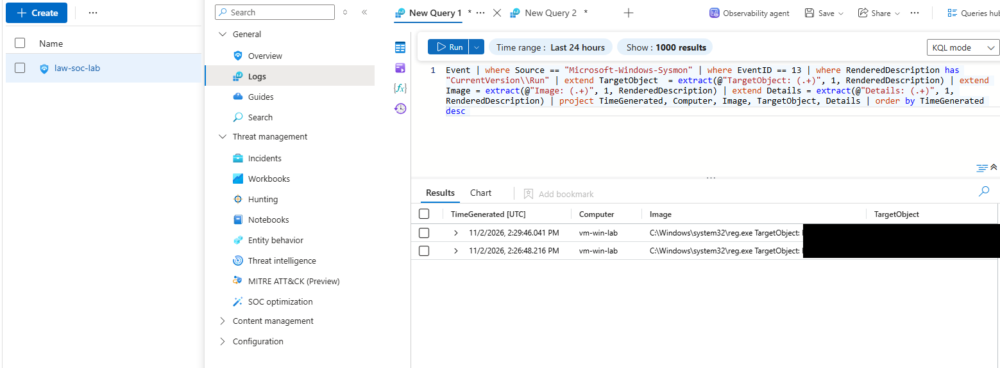</kbd></kbd><br>
<em>Two Sysmon Event 13 rows from <code>reg.exe</code>. The user SID is blacked out.</em>
</p>
<br>

<p align="center">
<kbd><kbd>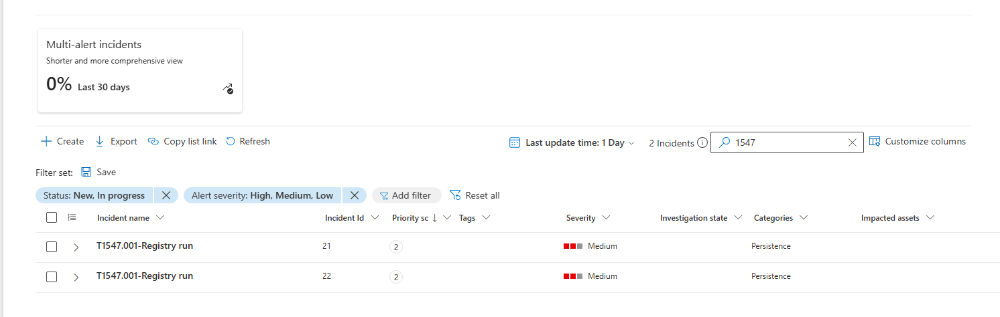</kbd></kbd><br>
<em>The registry run key rule made two incidents.</em>
</p>
<br>

## T1685.005: clearing the event log

Atomic test 1 runs `wevtutil cl System`. Windows writes a System Event 104, but I don't collect the System log, so I look for the process itself in Sysmon.

<p align="center">
<kbd><kbd>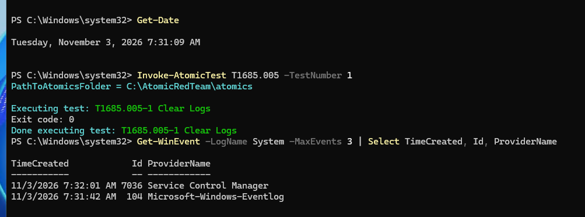</kbd></kbd><br>
<em>The log cleared on the VM, with System Event 104 showing up locally.</em>
</p>
<br>

```kql
Event
| where Source == "Microsoft-Windows-Sysmon"
| where EventID == 1
| where RenderedDescription has "wevtutil"
| project TimeGenerated, Computer, RenderedDescription
| order by TimeGenerated desc
```

<br>
<p align="center">
<kbd><kbd>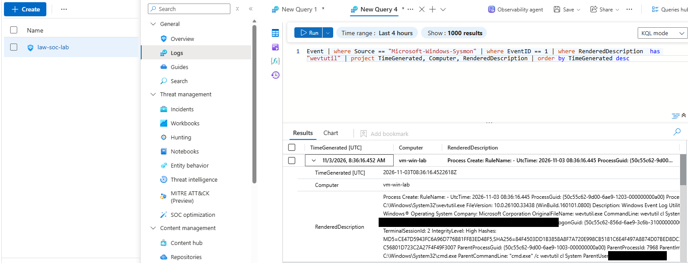</kbd></kbd><br>
<em>Sysmon process creation for <code>wevtutil cl System</code>, started by <code>cmd.exe</code>. Usernames are blacked out.</em>
</p>
<br>

<p align="center">
<kbd><kbd>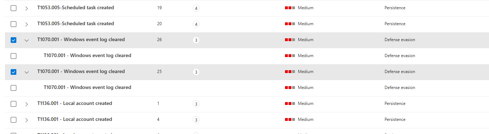</kbd></kbd><br>
<em>The log cleared rule made several incidents.</em>
</p>
<br>

## T1087.001: local account discovery

Atomic test 8 runs a few enumeration commands in a row: `net user`, `net localgroup`, `cmdkey /list` and `dir c:\Users\`. Each one shows up as a process creation event in Sysmon.

```kql
Event
| where Source == "Microsoft-Windows-Sysmon"
| where EventID == 1
| where RenderedDescription contains "net user"
    or RenderedDescription contains "net localgroup"
    or ParameterXml contains "cmdkey"
| extend CommandLine = extract(@"CommandLine: (.+)", 1, RenderedDescription)
| project TimeGenerated, Computer, CommandLine
| order by TimeGenerated desc
```

<br>
<p align="center">
<kbd><kbd>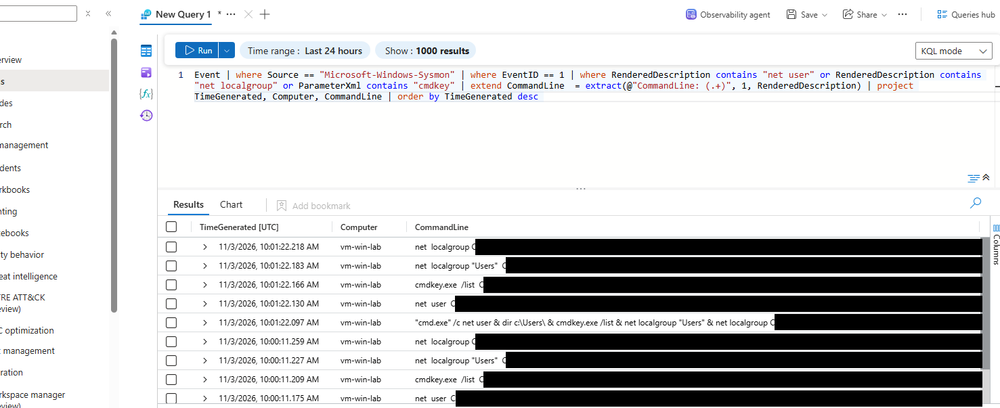</kbd></kbd><br>
<em>Each command from the test showing as its own Sysmon event, plus the parent <code>cmd.exe</code> line. I blacked out the username and folder part of each line.</em>
</p>
<br>

<p align="center">
<kbd><kbd>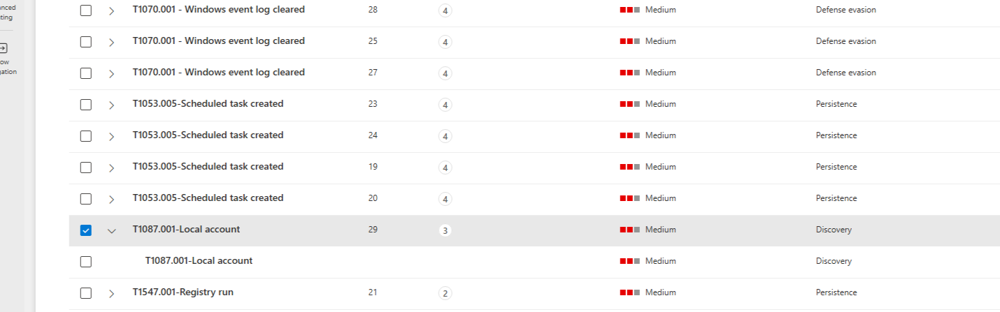</kbd></kbd><br>
<em>The account discovery incident.</em>
</p>
<br>

## T1059.003: Windows command shell

Atomic test 1 writes a batch file and runs it through `cmd.exe`.

<p align="center">
<kbd><kbd>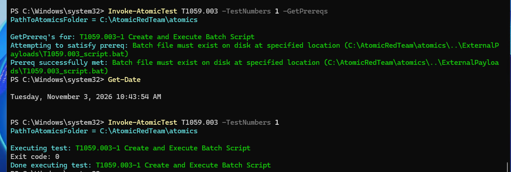</kbd></kbd><br>
<em>The prerequisite batch file created, then the test run.</em>
</p>
<br>

```kql
Event
| where Source == "Microsoft-Windows-Sysmon"
| where EventID == 1
| where RenderedDescription contains "T1059.003_script.bat"
| extend CommandLine = extract(@"CommandLine: (.+)", 1, RenderedDescription)
| extend ParentCommandLine = extract(@"ParentCommandLine: (.+)", 1, RenderedDescription)
| project TimeGenerated, Computer, CommandLine, ParentCommandLine
| order by TimeGenerated desc
```

<br>
<p align="center">
<kbd><kbd>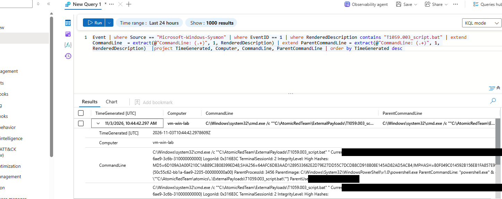</kbd></kbd><br>
<em>Sysmon process creation for the batch file. In this screenshot the ParentCommandLine column just repeats the command line, because I copied the same pattern into both. The query above is the fixed version.</em>
</p>
<br>

<p align="center">
<kbd><kbd>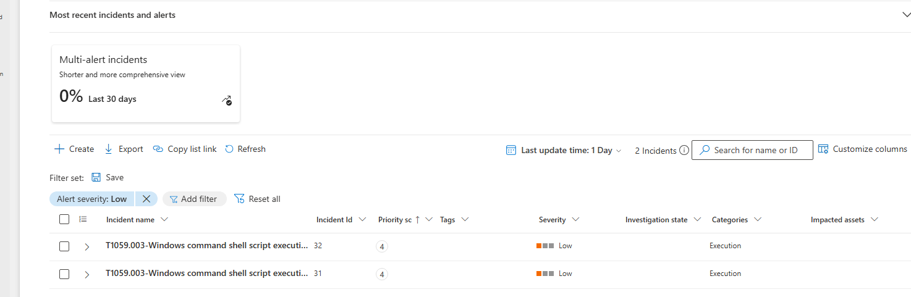</kbd></kbd><br>
<em>The command shell incident. I set this rule to Low severity.</em>
</p>
<br>

## All six rules

<p align="center">
<kbd><kbd>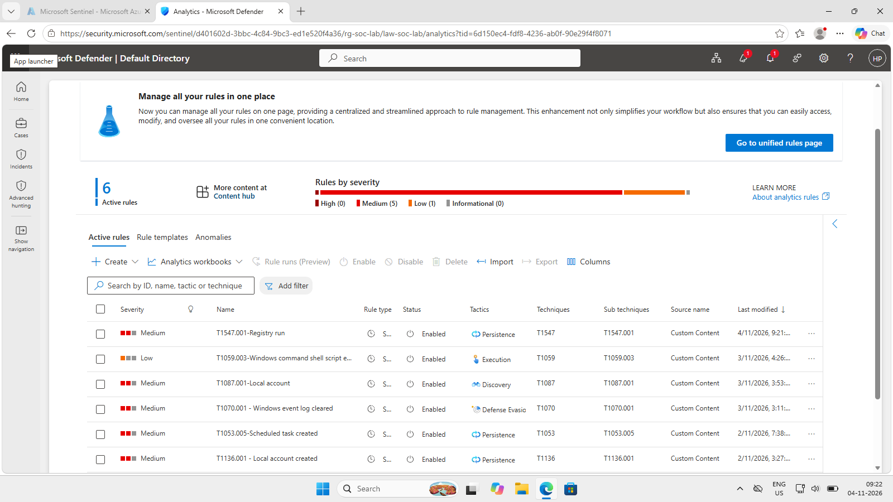</kbd></kbd><br>
<em>The six scheduled analytics rules, all enabled.</em>
</p>
<br>

### MITRE ATT&CK mapping

| Tactic | Technique | Evidence |
|---|---|---|
| Persistence | T1136.001 Create Account: Local Account | Security 4720 |
| Persistence | T1053.005 Scheduled Task | Security 4698 |
| Persistence | T1547.001 Registry Run Keys | Sysmon 13 |
| Defense Evasion | T1685.005 Clear Windows Event Logs | Sysmon 1, `wevtutil cl` |
| Discovery | T1087.001 Local Account Discovery | Sysmon 1, `net user` and similar |
| Execution | T1059.003 Windows Command Shell | Sysmon 1, batch file |

## If this were real

1. Check who ran it and from where. An admin creating an account during the day is different from a service account doing it at 3 AM.
2. For a new account or scheduled task, look at what it actually runs and whether anyone asked for it.
3. A cleared log is a bad sign. People clear logs to hide what they did, so I'd look at what happened just before it.
4. For discovery commands, look at what else that account and host did around the same time. One `net user` is normal, a burst of them followed by other commands is not.
5. Then decide whether to isolate the host or close the alert as expected admin activity.

## Limitations

- These are Atomic Red Team tests on one lab VM. They show the rules can see the behaviour, but not how they'd cope with real attackers or real noise.
- Some rules fired more than once for a single test. The scheduled task rule made four incidents. I haven't worked out why. My guess is the rule looks back further than it runs, but I didn't check.
- The rules match on text. The T1087.001 rule looks for `net user`, so a renamed or obfuscated command would get past it. The T1059.003 rule only matches the file name of my test, so it finds my test and not scripts in general.
- A lot of these commands are normal admin activity, so in a real environment the rules would need tuning to cut false positives.
- The log clearing rule looks for the `wevtutil` process, not the cleared log itself, because I don't collect the System log.
- A few run screenshots are cut off or don't show the clock. Where that happens, the query timestamps back them up.
- The lab stops working when my Azure credits run out on 16 Nov 2026, so the screenshots and queries are the record.

## What I actually learned from this

Writing the rules was the quick part. What took time was making sure the right log existed. The scheduled task rule needed an audit setting I didn't know about, the registry one needed Sysmon in Sentinel, and the log clearing test cleared a log I wasn't collecting. If the log isn't there, the rule has nothing to look at.

I also found out that a rule alerting isn't the same as a rule being good. A few of mine fired several times for one test, and the command shell one only matches my own test file, so I wouldn't call that one finished.

If I did this again, I'd work out which log each technique writes to before starting, turn on auditing and Sysmon first, and write down each rule's schedule and lookback as I go.

## Repo contents

```
sentinel-attack-simulation/
├── README.md
├── queries/
│   ├── 01_t1136_001_local_account_created.kql
│   ├── 02_t1053_005_scheduled_task_created.kql
│   ├── 03_t1547_001_registry_run_key.kql
│   ├── 04_t1685_005_event_log_cleared.kql
│   ├── 05_t1087_001_account_discovery.kql
│   └── 06_t1059_003_command_shell_script.kql
└── screenshots/   (34 images)
```
