# Watching the Azure Control Plane and Entra ID in Sentinel, Then Triaging What Fired

My earlier Sentinel labs only looked at what happened inside the Windows VM. This time I wanted to see the layer above it: who changes things in Azure itself, and what Entra ID records about users. Then I wanted to do the part of the job I hadn't really practised yet, which is opening the incidents my rules had been creating for a week and deciding what each one actually was.

Most of what I learned came from the triage. One of my own rules turned out to be mostly noise, and fixing it was the most useful thing I did all week. The earlier projects this builds on are [sentinel-attack-simulation](../sentinel-attack-simulation) and [sigma-detection-as-code](../sigma-detection-as-code).

## Lab environment

| Role | Name | Details |
|---|---|---|
| SIEM | Microsoft Sentinel | Workspace `law-soc-lab`, Central India, used through the unified Defender portal |
| Endpoint | `vm-win-lab` | The same Windows VM as before, kept stopped for most of this lab |
| Cloud logs | Azure Activity | Connected through an Azure Policy assignment at subscription scope |
| Identity | Entra ID | Free tenant, so audit logs only and no sign-in logs |
| Tables used | `AzureActivity`, `SecurityEvent`, `AuditLogs` | Plus my `SecurityEventParsed` parser from the Sigma project |

## Part 1: Getting Azure Activity logs in

Azure Activity is the log of everything done to Azure resources: creating a VM, changing a firewall rule, deleting a resource group. Windows logs can't see any of that. If someone with stolen Azure credentials opened RDP on my network security group, the VM's logs would only show the login that came afterwards.

The connector works through an Azure Policy assignment that creates the export setting for you. You have to tick "Create a remediation task", or the policy only applies to subscriptions created later.

<p align="center">
<kbd><kbd>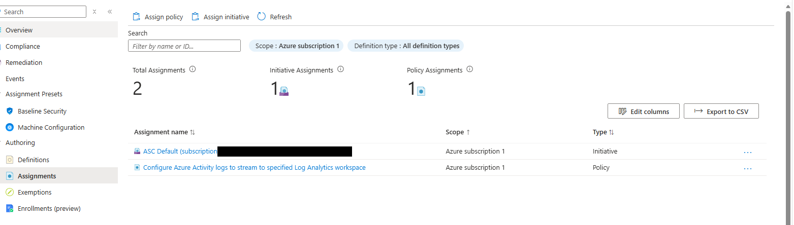</kbd></kbd><br>
<em>The policy assignment at subscription scope. The other assignment is Defender for Cloud's default; its subscription ID is blacked out.</em>
</p>
<br>

<p align="center">
<kbd><kbd>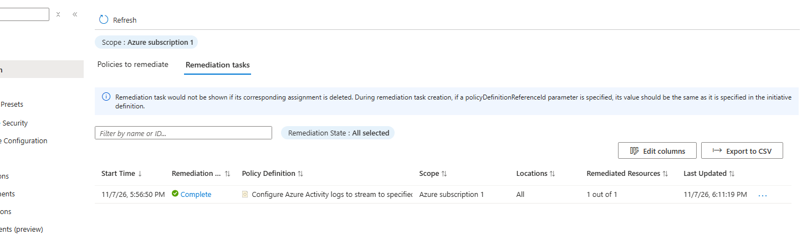</kbd></kbd><br>
<em>The remediation task finished, 1 out of 1 resources remediated.</em>
</p>
<br>

<p align="center">
<kbd><kbd>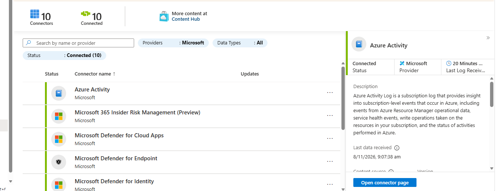</kbd></kbd><br>
<em>Azure Activity showing Connected. Most of the other connected entries came with the Defender portal and only receive data if those products are licensed, so I'm not counting them as sources I built.</em>
</p>
<br>

```kql
AzureActivity
| summarize Events = count(), Latest = max(TimeGenerated) by CategoryValue
```

<p align="center">
<kbd><kbd>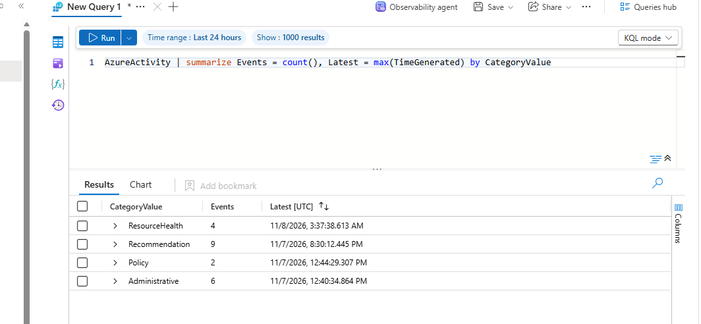</kbd></kbd><br>
<em>Data arriving: Administrative, Policy, Recommendation and ResourceHealth events.</em>
</p>
<br>

## Part 2: Planting a firewall mistake and catching it

I created a network security group called `nsg-misconfig-test` and added a rule allowing RDP (3389/TCP) from Any. That's the classic misconfiguration bots scan for. I didn't attach the NSG to any VM or subnet, so it filtered nothing and nothing was exposed, but Azure still logs the change exactly as it would for a real one.

<p align="center">
<kbd><kbd>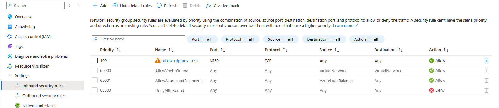</kbd></kbd><br>
<em>The planted rule at priority 100, with the portal's warning icon next to it.</em>
</p>
<br>

<p align="center">
<kbd><kbd>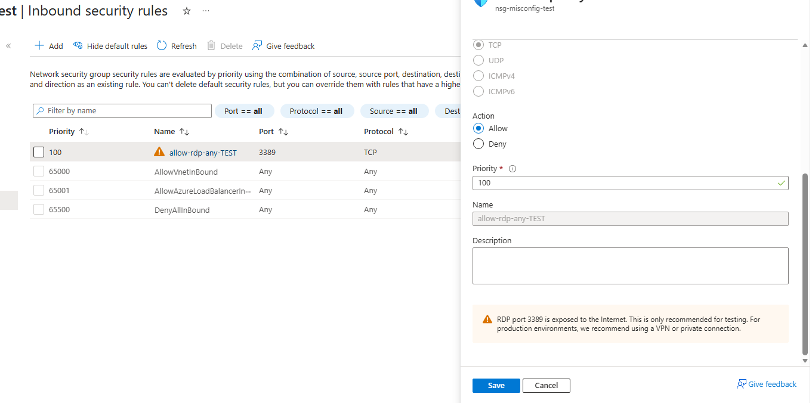</kbd></kbd><br>
<em>The warning text: "RDP port 3389 is exposed to the Internet. This is only recommended for testing."</em>
</p>
<br>

The portal warned me, but nobody in a SOC sees a warning on a web page, and a change made through the CLI or the API shows no warning at all. So I looked for the change in the logs.

```kql
AzureActivity
| where OperationNameValue =~ "MICROSOFT.NETWORK/NETWORKSECURITYGROUPS/SECURITYRULES/WRITE"
| where ActivityStatusValue in~ ("Success", "Succeeded")
| project TimeGenerated, Caller, CallerIpAddress, ResourceGroup,
          Rule = tostring(split(_ResourceId, "/")[-1]), _ResourceId
```

<p align="center">
<kbd><kbd>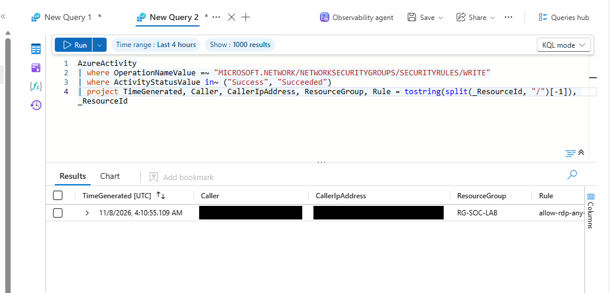</kbd></kbd><br>
<em>The rule creation at 04:10:55 UTC. Caller and CallerIpAddress are blacked out because they're my email and home IP.</em>
</p>
<br>

Next I wanted to see whether the log said what the rule allowed, so I could alert only on dangerous changes. I went through every field in `Properties_d` and there was no port, no source and no request body. The Activity log records who changed a rule, when and from where, but not what the rule says.

<p align="center">
<kbd><kbd>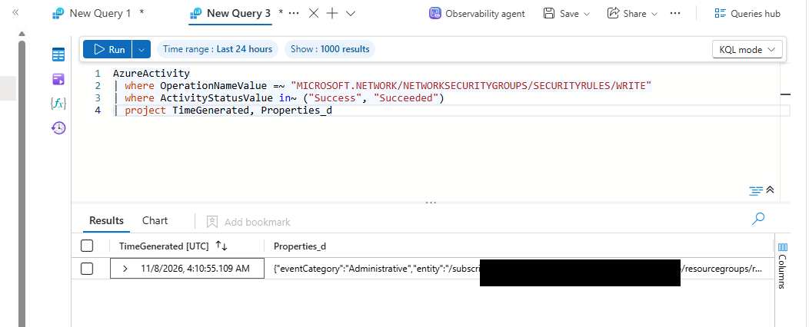</kbd></kbd><br>
<em>The event properties. There's no rule content anywhere in them. The subscription ID is blacked out.</em>
</p>
<br>

That changed how I wrote the detection. The rule can only say "a firewall rule was created, changed or deleted", and checking whether it's dangerous becomes the analyst's first triage step. I included deletes as well, because removing a Deny rule can open access just as easily as adding an Allow.

- Runs every 15 minutes and looks back 30, because Activity logs can arrive up to about 15 minutes late.
- Maps Caller to Account, CallerIpAddress to IP and the resource ID to Azure resource.
- Alert grouping is on (all entities match, 1 hour), because my earlier rules had been creating duplicate incidents.
- Mapped to MITRE T1562.007 (Disable or Modify Cloud Firewall).

<p align="center">
<kbd><kbd>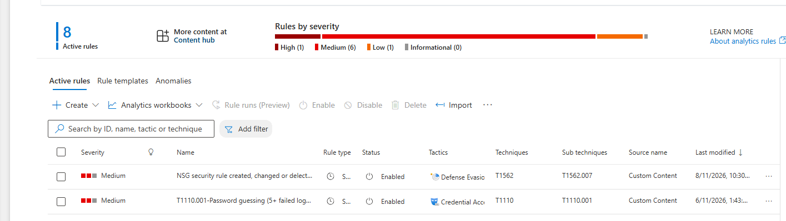</kbd></kbd><br>
<em>The new rule enabled, listed under Defense Evasion with T1562.007.</em>
</p>
<br>

To test it, I deleted the RDP rule, which gave the detection a fresh event. The incident appeared about 20 minutes later. After that I deleted the whole test NSG.

<p align="center">
<kbd><kbd>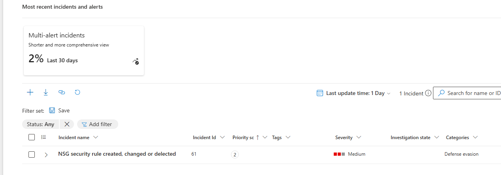</kbd></kbd><br>
<em>Incident 61 created from the rule.</em>
</p>
<br>

## Part 3: Failed logons, two ways

The brute force rule from my attack-simulation project uses a fixed threshold (5 failures in 10 minutes). I wanted to try the other approach too, which asks whether an hour is unusual compared with normal. The 4625 data comes from that project's brute force test.

```kql
SecurityEvent
| where EventID == 4625
| summarize Failures = count(), Accounts = dcount(TargetAccount),
            SourceIPs = make_set(IpAddress, 5) by bin(TimeGenerated, 1h), Computer
| order by TimeGenerated desc
```

<p align="center">
<kbd><kbd>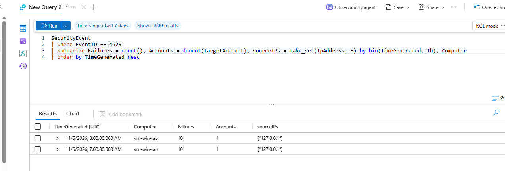</kbd></kbd><br>
<em>Two hours on 6 Nov with 10 failures each, against a single account.</em>
</p>
<br>

One account with lots of failures is brute force. Lots of accounts with a few failures each would be password spraying, which is a different attack, so `dcount(TargetAccount)` is what tells them apart. The source IP is `127.0.0.1` because I ran the test on the VM itself.

For the anomaly version I used `make-series` to build an hourly timeline and `series_decompose_anomalies` to learn a baseline and flag hours far above it.

<p align="center">
<kbd><kbd>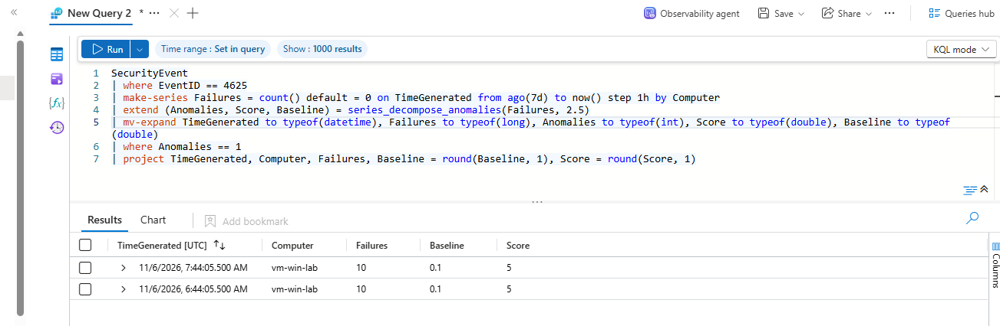</kbd></kbd><br>
<em>Both test hours flagged: 10 failures against a baseline of 0.1, score 5.</em>
</p>
<br>

It flagged them only because seven days of a quiet lab VM gives a baseline of almost zero, so any burst at all stands out. The method needs weeks of real traffic before it means anything.

## Part 4: Impossible travel without sign-in data

I wanted to write an impossible-travel query: if the same user signs in from two places faster than a plane could fly between them, one of those sign-ins probably isn't them. My tenant is Entra ID Free, though, and sign-in logs need a P1 or P2 licence, so `SigninLogs` was empty. I built the logic on six made-up sign-ins instead, using IP ranges reserved for documentation.

<p align="center">
<kbd><kbd>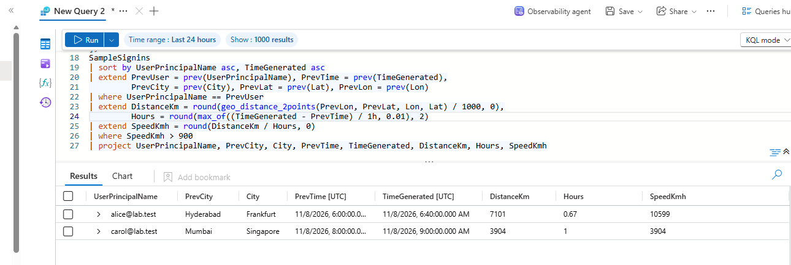</kbd></kbd><br>
<em>alice: Hyderabad to Frankfurt, 7,101 km in 0.67 hours, 10,599 km/h. carol: Mumbai to Singapore, 3,904 km/h. bob's 3-hour trip to Bengaluru wasn't flagged.</em>
</p>
<br>

Two things to watch here. `geo_distance_2points` takes longitude first and latitude second, and swapping them gives wrong distances without any error. Carol's case is the classic false positive for this detection: a VPN or company proxy can make someone look like they jumped countries, so the first triage step is checking whether the far IP belongs to one.

## Part 5: Entra ID

I installed the Microsoft Entra ID solution and turned on Audit logs and Sign-in logs in the connector. The connector itself shows the licence problem.

<p align="center">
<kbd><kbd>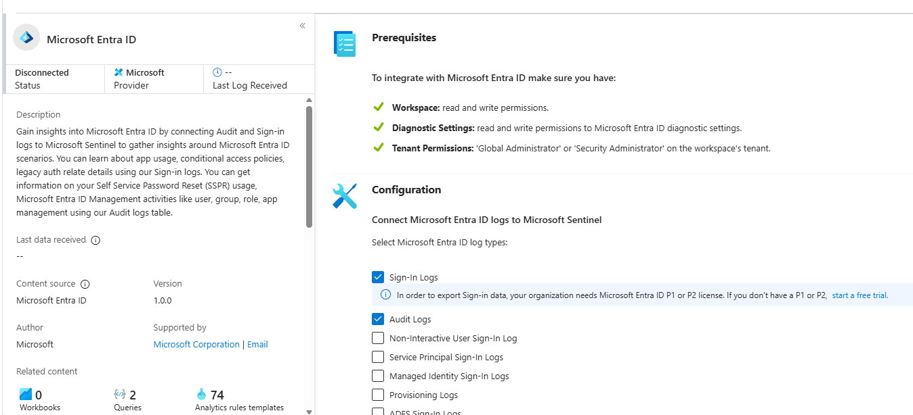</kbd></kbd><br>
<em>Both log types ticked, with Microsoft's note that sign-in export needs P1 or P2. Taken before any data arrived, so it still says Disconnected.</em>
</p>
<br>

<p align="center">
<kbd><kbd>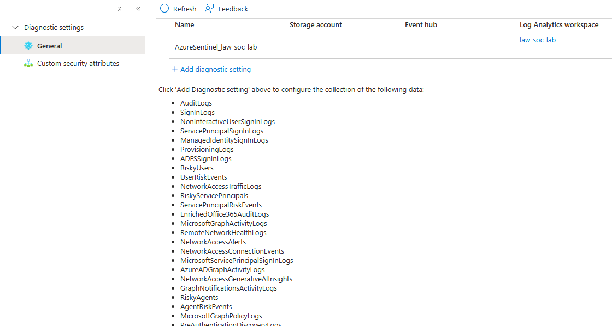</kbd></kbd><br>
<em>The diagnostic setting the connector created, sending to <code>law-soc-lab</code>.</em>
</p>
<br>

To test it, I created a user called `soc-test-user`. I created it disabled and with no roles, because an enabled account with a password nobody is tracking is exactly the kind of thing attackers look for.

Two days later `AuditLogs` was still empty. The setting was correct and the user existed, so the event had happened but never arrived. I created the user about five minutes after turning the export on, and that seems to have been before it was actually active. When I deleted the user on 10 Nov, the Delete user event showed up within about 13 minutes.

<p align="center">
<kbd><kbd>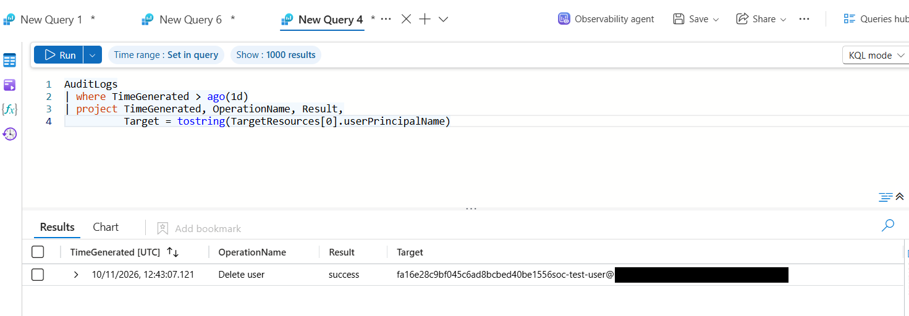</kbd></kbd><br>
<em>The Delete user event in AuditLogs. The tenant domain is blacked out.</em>
</p>
<br>

The strange-looking name is because Entra soft-deletes users and puts the object ID in front of the original name. If I were investigating a deleted account, I'd need to search with `has` instead of `==`.

I also noticed that the tenant's overview page has an alert saying it's still on the legacy MFA and self-service password reset policies, past Microsoft's September 2025 migration date. In a real company that would go in a report as a recommendation to migrate.

## Part 6: Triaging what my rules had been creating

There were 61 incidents in the queue, most of them from my own rules over the past week. I worked through everything from the scheduled task rule (T1053.005) plus the new NSG incident.

The scheduled task alerts had a problem straight away: the SubjectUserName column in the alert was blank, so I couldn't see who created the task. I had to go back to the raw 4698 events.

```kql
SecurityEventParsed
| where TimeGenerated > ago(14d)
| where EventID == 4698
| summarize Count = count(), First = min(TimeGenerated), Last = max(TimeGenerated)
          by SubjectUserName, TaskName
| order by SubjectUserName asc
```

<p align="center">
<kbd><kbd>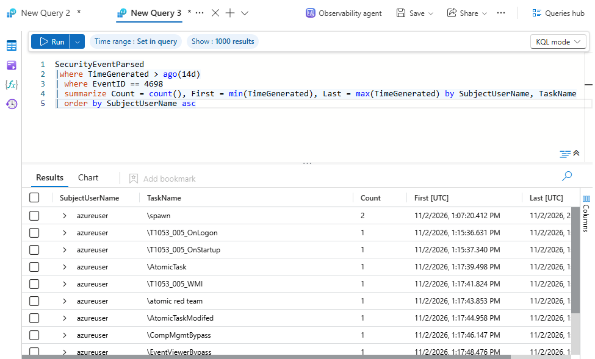</kbd></kbd><br>
<em>Every task created by <code>azureuser</code> is one of my Atomic Red Team tests, all on 2 Nov.</em>
</p>
<br>

There were two very different groups. Tasks created by `azureuser` with names like `\T1053_005_OnLogon` were my tests. Tasks created by `vm-win-lab$` under `\Microsoft\Windows\Windows Defender\` were Windows maintaining itself. An account ending in `$` is the computer's own account, so a person didn't do it.

For each incident I checked the time, pivoted to the raw event, and wrote a note before closing it. The full notes are in [`triage/`](triage/).

<p align="center">
<kbd><kbd>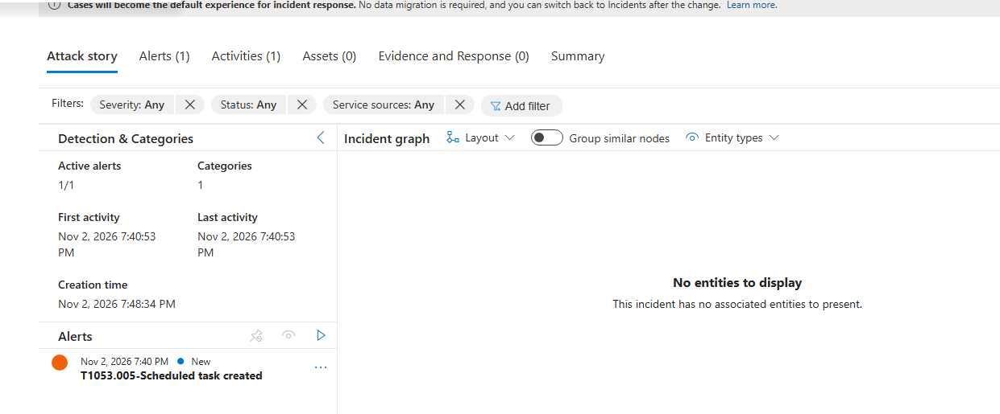</kbd></kbd><br>
<em>Incident 19: the <code>\spawn</code> task from my test. No entities, which is one of the rule problems below. The header with the Resolved status is cut off in this screenshot.</em>
</p>
<br>

<p align="center">
<kbd><kbd>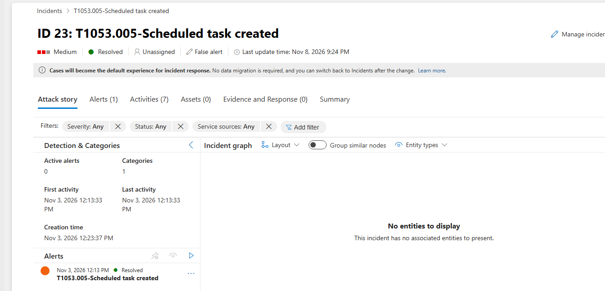</kbd></kbd><br>
<em>Incident 23 resolved as a false positive: a Microsoft built-in task created by the machine account.</em>
</p>
<br>

The NSG incident had two alerts in it. Both were the same delete event, caught by two overlapping runs of the rule, and alert grouping put them into one incident instead of two.

<p align="center">
<kbd><kbd>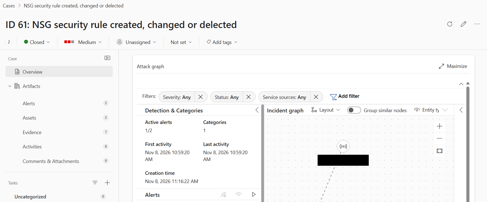</kbd></kbd><br>
<em>Incident 61. I took this before the classification saved, so it still says Not set here; screenshot 68 shows the final verdict. My IP is blacked out in the graph.</em>
</p>
<br>

| Incident | Rule | Verdict | Reason |
|---|---|---|---|
| 19 | T1053.005 | Benign positive | `azureuser` created `\spawn` during my Atomic Red Team test |
| 20 | T1053.005 | Duplicate of 19 | Same event, picked up by the next run |
| 23 | T1053.005 | False positive | Microsoft built-in task created by `vm-win-lab$` |
| 24 | T1053.005 | Duplicate of 23 | Same event |
| 34 | T1053.005 | False positive | Windows Defender Scheduled Scan, created by the OS |
| 49 | T1053.005 | False positive | Windows Defender task, created by the OS |
| 54 | T1053.005 | Duplicate of 49 | Same event |
| 61 | NSG rule change | Benign positive | My planted test |

<p align="center">
<kbd><kbd>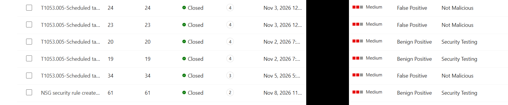</kbd></kbd><br>
<em>The closed incidents with their classifications. The assigned-to column is blacked out.</em>
</p>
<br>

The scheduled task rule had made 7 incidents from only 4 real events: one test, three Windows tasks and three duplicates. Only 2 of the 7 had anything to do with what the rule is meant to catch.

## Part 7: Fixing the rule

The duplicates came from the schedule. The rule ran every 5 minutes but looked back 10, so most events were seen by two runs. I kept the overlap, because logs can arrive late and I didn't want to miss them, and turned on alert grouping instead.

For the noise, the easy option was to exclude all machine accounts. I didn't, because malware running as SYSTEM also shows up as `vm-win-lab$`, and that would hide it. I only excluded the exact combination I'd proved was harmless.

```kql
SecurityEventParsed
| where EventID == 4698
| where not(SubjectUserName endswith "$" and TaskName startswith @"\Microsoft\Windows\")
| project TimeGenerated, Computer, SubjectUserName, SubjectUserSid, TaskName
```

I also added Host and Account entity mapping (so incidents stop saying "No entities"), made the query output SubjectUserName, and wrote a rule description with triage hints, because the description field had been empty.

<p align="center">
<kbd><kbd>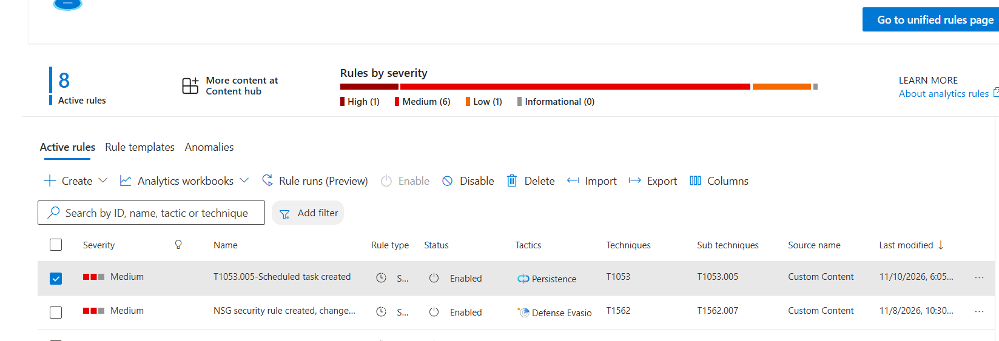</kbd></kbd><br>
<em>The T1053.005 rule after saving the changes, last modified 10 Nov.</em>
</p>
<br>

<p align="center">
<kbd><kbd>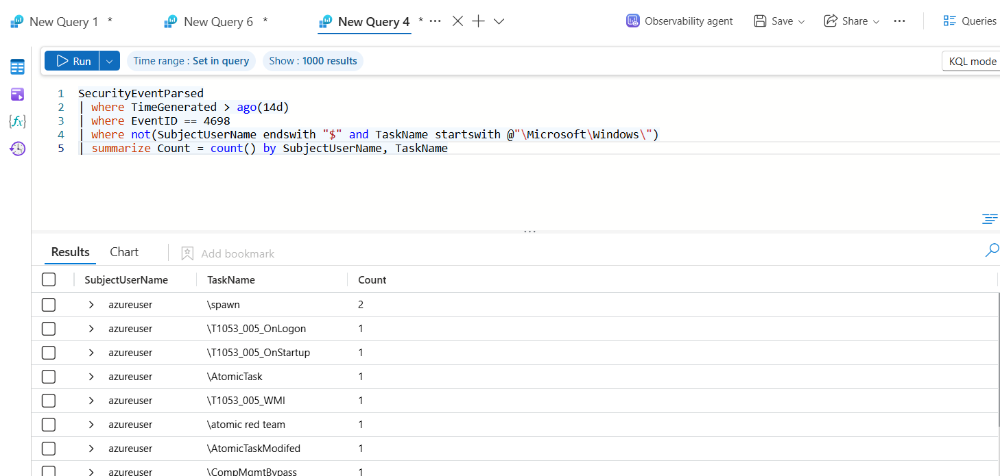</kbd></kbd><br>
<em>The tuned logic over 14 days: only my <code>azureuser</code> test tasks remain.</em>
</p>
<br>

Over 14 days the logic matched 18 task-creation events before the change and 12 after. The 6 removed were all Microsoft tasks created by `vm-win-lab$`, and all 12 left are my tests, so nothing I wanted to catch was lost.

There's still a gap. An attacker running as SYSTEM who names their task under `\Microsoft\Windows\` would be filtered out too. That's a known trick (masquerading, T1036), and the next step would be checking where the task's program actually lives, for example in Temp or AppData.

## Everything that needed fixing along the way

**Wrong policy scope.** The policy wizard filled in my resource group as the scope. The Activity log belongs to the subscription, so it would have configured nothing and shown no error. I changed it to the subscription.

**Wrong Entra solution.** The first result in Content hub was Microsoft Entra ID Protection, which is a different product that needs P2. The one I needed was just called Microsoft Entra ID.

**The install failed.** The Marketplace deployment failed with `InvalidTemplate` because the `location` parameter was empty. I reinstalled from inside the workspace's Content hub and it worked. I also left out the 11 playbooks it offered, because they're Logic Apps I had no use for.

**Typos in my own queries.** I mixed up the types in an `mv-expand` line, and in another query I used `ClientIPAddress` instead of `IpAddress`, which gave an empty column. Both queries ran without an error and quietly gave me the wrong answer.

**Time zones.** The Defender portal shows times in India time and the Logs page shows UTC. An alert that said 7:40 PM was 14:10 UTC, and I had to convert every time before pivoting.

**Classifications that didn't save.** The portal switched to a new Cases layout while I was working. Two incidents ended up Closed with no classification because status and classification are separate controls there. I had to go back and set them.

**I saved a pivot query into the live rule.** I meant to copy the rule's query out for review. Instead I pasted my one-day pivot query into the rule and saved it. With a fixed date in it, the rule would never have fired again. I caught it when I went back to the rule, and replaced it with the tuned version.

## If this were real

1. For the NSG alert, open the rule straight away and check its port, source and action, because the alert can't tell you.
2. Check whether the Caller normally changes network settings and whether CallerIpAddress is somewhere they usually work from.
3. If it opened RDP or SSH to Any, revert it, then check the VM's sign-in logs from that point on for anyone who got in.
4. For a scheduled task, look at who created it, what the task runs and where that program lives. A machine account creating a Microsoft task is normal; a user account creating one that runs something from Temp is not.
5. Close false positives with a tuning fix, or they'll be back tomorrow.

## Limitations

- One VM and one tenant, mostly quiet, with test activity I made myself. The numbers are small.
- The anomaly baseline is almost zero because the VM was off most of the time.
- There's no real sign-in data, so impossible travel was only tested on made-up rows.
- Screenshots 65 and 67 don't show the final Resolved status and classification; screenshot 68 does.
- My Azure credits end on 16 Nov 2026, so after that the lab won't exist. The queries, notes and screenshots here are the record.

## What I actually learned from this

Building detections was the easy part again. The harder and more useful part was triage: opening each incident, refusing to guess, and checking the raw event when the alert didn't tell me enough. Doing that showed me my scheduled task rule was mostly creating work for nobody, and the fix only became obvious once I'd closed the same false positive three times.

I also learned to find out what a log can't tell me before I write a rule on it, like the missing rule contents in Azure Activity. And I learned to test a new log source with a real event before trusting it, because a connector that says Connected doesn't mean the data is arriving.

Next I want to export the two rules as JSON, add a check on the task's program path to close the masquerading gap, and record short demo videos while the workspace still exists.

## Repo contents

```
sentinel-cloud-identity-ops/
├── README.md
├── queries/
│   ├── 01-azureactivity-by-category.kql
│   ├── 02-nsg-rule-change-detection.kql
│   ├── 03-failed-logins-hourly.kql
│   ├── 04-failed-logins-anomaly.kql
│   ├── 05-impossible-travel-sample.kql
│   ├── 06-schtask-4698-summary.kql
│   ├── 07-schtask-tuned-rule.kql
│   └── 08-triage-pivot-4698.kql
├── triage/        (5 incident notes and a duplicates list)
├── rules/         (rule exports, to be added)
└── screenshots/   (23 images)
```
