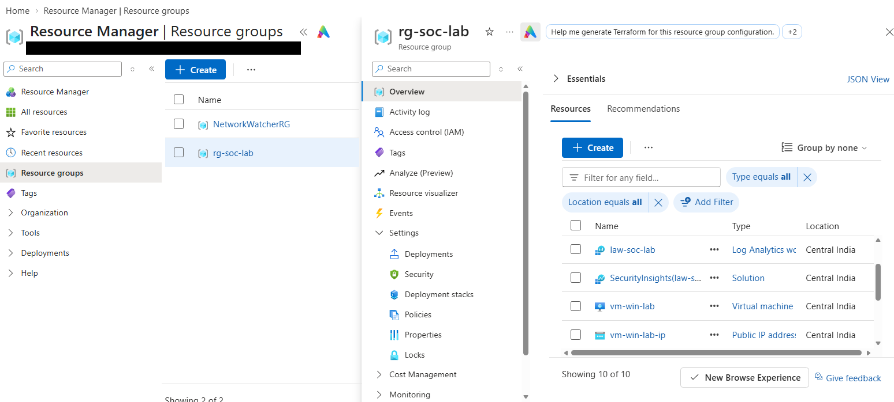
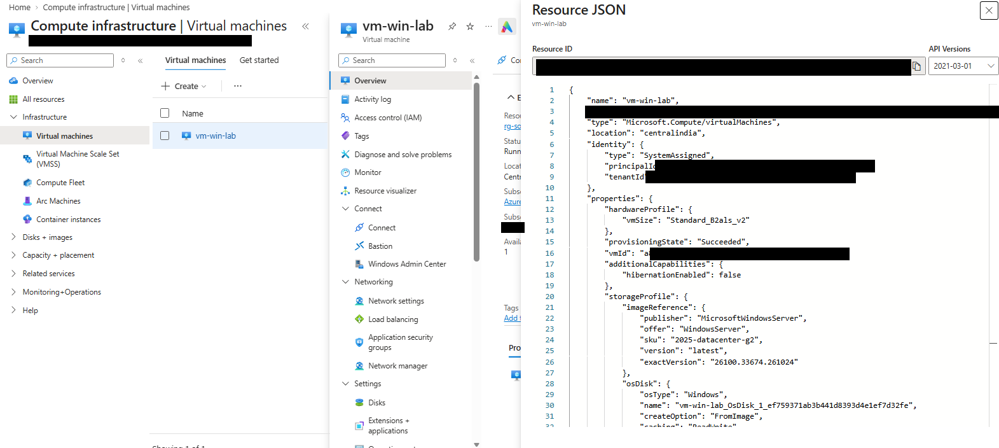
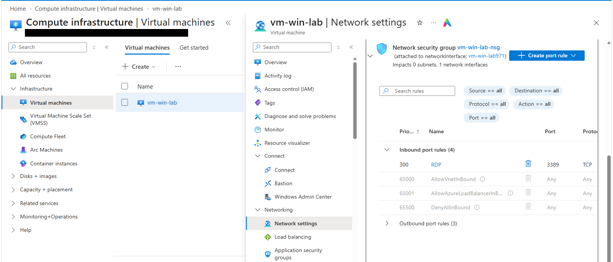
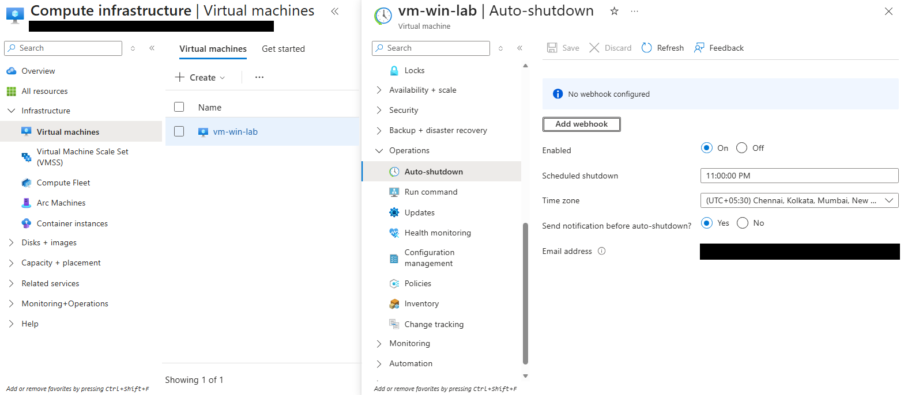
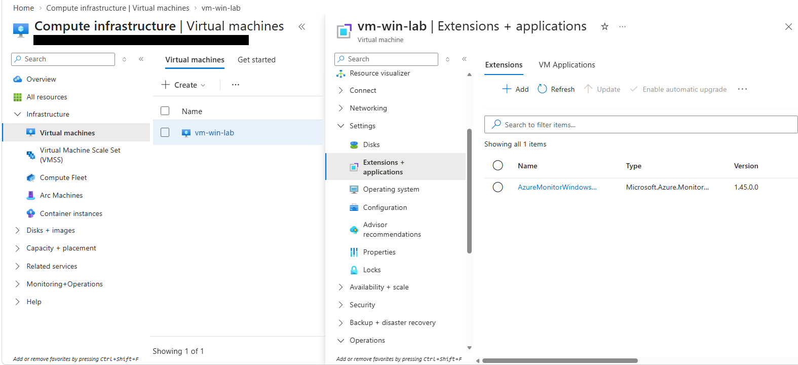
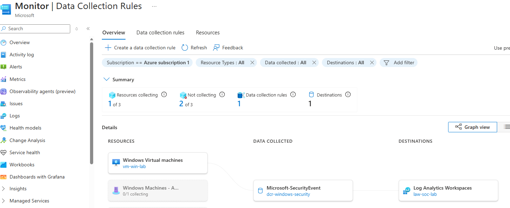
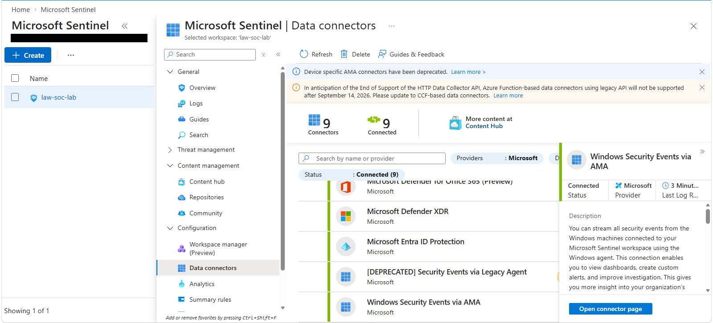
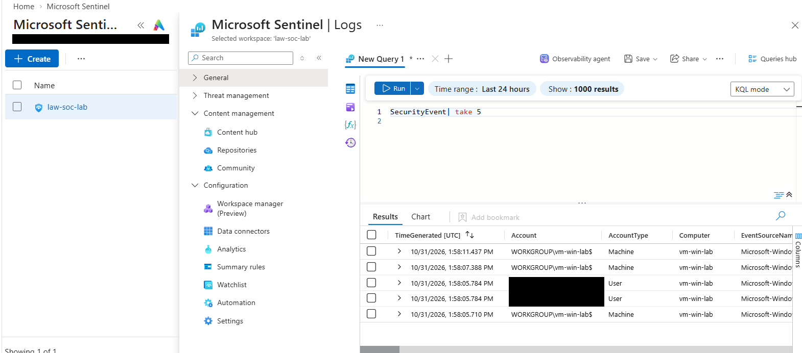
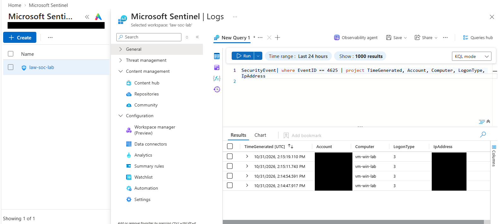
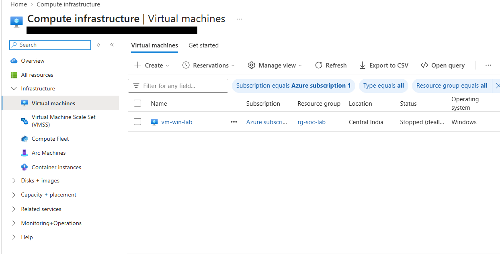

# Getting Windows Logs into Microsoft Sentinel and Finding Failed Logons (KQL)

After the encoded PowerShell hunt, I wanted to build the log pipeline myself instead of using a machine that was already set up. This time the target was a brand new Windows VM in Azure, and the goal was simple: get its Security logs into Microsoft Sentinel, prove they were arriving, and then find a failed logon that I caused on purpose.

Most of the work was setup, so this write-up is mostly about how the data got there, and a smaller part about what I did with it once it arrived. My earlier project is here: [kql-encoded-powershell](../kql-encoded-powershell).

## Lab environment

| Role | Name | Details |
|---|---|---|
| Target machine | `vm-win-lab` | Windows Server 2025 Datacenter, Azure VM, size B2als_v2, Central India |
| SIEM | Microsoft Sentinel | Workspace `law-soc-lab`, Central India, on the 31-day free trial |
| Log collection | Azure Monitor Agent | Connector: Windows Security Events via AMA (All Security Events) |
| Data collection rule | `dcr-windows-security` | Attached to `vm-win-lab` |
| Table / Event ID | `SecurityEvent` / 4625 | Failed logon |

## How I set this up

I forgot to take screenshots while I was creating the VM, so the screenshots below were taken afterwards from the finished resources. I'm saying that now so it doesn't look like something it isn't.

Everything lives in one resource group, `rg-soc-lab`, so I can delete it in one go when I'm finished. It holds the workspace, the Sentinel solution, the VM and its public IP.

<p align="center">
<kbd><kbd></kbd></kbd><br>
<em>The resources in <code>rg-soc-lab</code>: the Log Analytics workspace, the Sentinel solution, the VM and its public IP.</em>
</p>
<br>

The VM runs Windows Server 2025 on a small B2als_v2 size. I picked a small one because I'm paying with free credits.

<p align="center">
<kbd><kbd></kbd></kbd><br>
<em>The VM's JSON showing size <code>Standard_B2als_v2</code> and the Windows Server 2025 image. IDs are blacked out.</em>
</p>
<br>

While I was creating it, Azure warned that RDP on port 3389 would be open to every IP address. Bots scan for that all the time, so after the VM was created I changed the source on the RDP rule to my own IP.

<p align="center">
<kbd><kbd></kbd></kbd><br>
<em>The network security group with the RDP rule on port 3389. I set the source to my own IP, but the source column is cut off in this screenshot.</em>
</p>
<br>

I also turned on auto-shutdown so I can't forget the VM overnight and burn my credits.

<p align="center">
<kbd><kbd></kbd></kbd><br>
<em>Auto-shutdown enabled for 11:00 PM India time. My notification email is blacked out.</em>
</p>
<br>

Then I installed the Windows Security Events solution from Sentinel's Content hub and created a data collection rule from the connector. Creating the rule is what deploys the Azure Monitor Agent onto the VM.

<p align="center">
<kbd><kbd></kbd></kbd><br>
<em>The Azure Monitor Agent (version 1.45.0.0) installed on the VM. The status column is cut off here.</em>
</p>
<br>

<p align="center">
<kbd><kbd></kbd></kbd><br>
<em>The data flow in Azure Monitor: <code>vm-win-lab</code> to <code>Microsoft-SecurityEvent</code> (rule <code>dcr-windows-security</code>) to <code>law-soc-lab</code>. The greyed-out entry is from my previous lab.</em>
</p>
<br>

<p align="center">
<kbd><kbd></kbd></kbd><br>
<em>Windows Security Events via AMA showing Connected. The list also has the old legacy agent connector, which is deprecated, and I didn't use it.</em>
</p>
<br>

## Everything that needed fixing first

**VM size.** The size Azure picked for me by default said it was unavailable in Central India for my subscription (`NotAvailableForSubscription`). I opened the full size list, filtered for 2 vCPUs and 4 GB of RAM, and chose a B-series size that was actually available.

**Wrong operating system.** The portal defaulted to an Ubuntu image. This lab needs Windows event logs, so I changed it to Windows Server 2025. I skipped Windows Server Core because it has no desktop, and Windows 11 because Azure's Windows 11 images need specific licensing.

**Certificate warning.** The first RDP connection warned that the certificate wasn't from a trusted authority. The VM makes its own certificate when it first starts, so that's expected. I checked that the certificate name matched `vm-win-lab` and then accepted it.

**The Monitor page said I had no rules.** Azure Monitor's overview showed zero data collection rules even though Sentinel listed one. I opened the rule's Resources tab to check that the VM was attached, and later the overview caught up on its own. The dashboard was just slow, so I learned to check the rule itself instead of trusting the summary.

## Making sure the data was actually arriving

Before doing anything else, I checked that Windows events were landing in the workspace at all.

```kql
SecurityEvent
| take 5
```

<br>
<p align="center">
<kbd><kbd></kbd></kbd><br>
<em>Security events from <code>vm-win-lab</code> in the <code>SecurityEvent</code> table. Some account names are blacked out.</em>
</p>
<br>

Events were coming in from `vm-win-lab`, and several were under the machine's own account (`AccountType` is Machine), which is normal background activity. That told me the pipeline worked end to end.

## Causing a failed logon on purpose

When I first searched for failed logons, there was nothing. That wasn't a mistake in the query. I hadn't failed a login yet, so Windows hadn't logged any EventID 4625. To create some, I opened an RDP connection from my laptop and typed a wrong password a few times.

```kql
SecurityEvent
| where EventID == 4625
| project TimeGenerated, Account, Computer, LogonType, IpAddress
```

<br>
<p align="center">
<kbd><kbd></kbd></kbd><br>
<em>Four failed logons on <code>vm-win-lab</code>. The Account and IpAddress columns are blacked out.</em>
</p>
<br>

All four have `LogonType` 3, which is a network logon. That fits RDP when Network Level Authentication is on, because the password gets checked over the network before the full session starts. The four attempts landed within about 30 seconds of each other, because I typed them one after another.

### What this would map to

| Tactic | Technique | Evidence |
|---|---|---|
| Credential Access | T1110 Brute Force | Several EventID 4625 events, LogonType 3, in a short window |

This is only the shape a brute force rule looks for. Four attempts from me is a test, not an attack, so I'm not calling it a detection.

## If this were real

1. Look at the source IP and decide whether it's a known address or a stranger.
2. Check which account was targeted and whether it exists.
3. Look for a successful logon (EventID 4624) from the same IP right after the failures, because that could mean the guess worked.
4. Check how many attempts there were and over how long, to separate a typo from a script.
5. If it looks real, block the IP at the network security group and reset the account's password.

## Stopping the lab

When I finished, I stopped the VM from the Azure portal and waited until it said Stopped (deallocated). Shutting down from inside Windows still bills for the VM, so that distinction matters.

<p align="center">
<kbd><kbd></kbd></kbd><br>
<em>The VM stopped. The status is cut off in the column but reads Stopped (deallocated).</em>
</p>
<br>

## Limitations

- The data is normal VM activity plus four failed logons that I caused myself. I didn't simulate a real attack.
- There is no analytics rule and no incident, so this is ingestion and querying, not a working detection.
- I wanted to add Sysmon too, but I got confused about which machine I was working on and ran out of time. It's left for the next part.
- Some of the screenshots (03, 05 and 10) have a cut-off column, so they show less than I meant them to.
- My Azure free credits expire on 16 Nov 2026, so after that date the lab won't exist. The screenshots and queries are the record.

## What I actually learned from this

The KQL was the easy part again. The real work was the pipeline: choosing a VM size my subscription actually allowed, picking the right operating system, understanding that the data collection rule is what installs the agent, and finding out that an empty result can just mean the event never happened. I also learned to check the thing itself, not the summary page.

If I did this again, I'd take screenshots as I go instead of afterwards, and I'd check the VM size and region before filling in the rest of the form. Next time I want to add Sysmon, send its logs to Sentinel, and write a rule that alerts when one IP fails to log in several times in a few minutes.

## Repo contents

```
sentinel-windows-security-lab/
├── README.md
├── queries/
│   ├── 01_verify_ingestion.kql
│   └── 02_failed_logons_4625.kql
└── screenshots/   (10 images)
```
